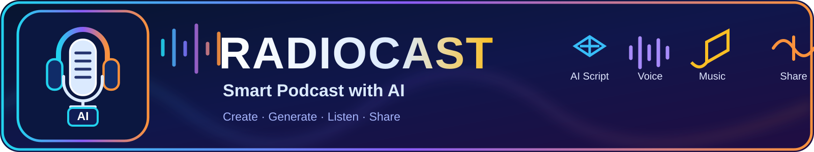

<div align="center">



# RADIOCAST

### استودیوی هوشمند ساخت پادکست · AI-Powered Podcast Studio

**از متن خام تا یک برنامه صوتی خوش‌ساخت؛ با کمک هوش مصنوعی، صدای طبیعی و میکس موسیقی.**

<p>
  <a href="#فارسی">فارسی</a> ·
  <a href="#english">English</a> ·
  <a href="https://github.com/yusi20006-max/RADIOCAST/actions">وضعیت ساخت</a>
</p>

<p>
  
  
  
</p>

</div>

---

<a id="فارسی"></a>

## 🎙️ درباره RADIOCAST

**رادیوکست** یک استودیوی تولید پادکست با کمک هوش مصنوعی است. متن یا ایده‌ات را وارد کن، سناریوی گفت‌وگومحور بساز، صداها و موسیقی را انتخاب کن و خروجی صوتی آماده انتشار بگیر.

رادیوکست برای ساخت اپیزودهای فارسی طراحی شده و به ارائه‌دهنده‌های مختلف هوش مصنوعی متصل می‌شود؛ بنابراین می‌توانی سرویس و مدل دلخواهت را در تنظیمات وارد کنی.

## ✨ قابلیت‌ها

| قابلیت | توضیح |
|---|---|
| 🧠 **سناریونویسی با AI** | تبدیل متن خام به سناریوی رادیویی ساختاریافته و گفت‌وگوی چندگوینده‌ای، همراه با سرفصل‌ها و یادداشت‌های برنامه |
| 🎧 **تولید صدای هوشمند** | تولید دیالوگ‌ها با صداهای قابل انتخاب، لحن‌های متناسب با محتوا و کنترل سرعت گویندگان |
| 🎚️ **میکس و موسیقی** | ترکیب صدای گویندگان با موسیقی زمینه، کاهش خودکار صدای موسیقی هنگام گفتگو (Audio Ducking) و افکت‌های صوتی |
| 💾 **پروژه‌های قابل ادامه** | ذخیره خودکار پروژه‌ها و بخش‌های صوتی تولیدشده؛ بازکردن پروژه نیمه‌تمام و ادامه از همان مرحله |
| 🎼 **پیش‌شنوی آفلاین موسیقی** | پیش‌شنوی محلی نمونه‌های موسیقی زمینه پیش از انتخاب و میکس نهایی |
| 📦 **خروجی و انتشار** | خروجی صوتی MP3 و WAV، اطلاعات اپیزود و یادداشت‌های برنامه |
| 🎨 **طراحی کاور** | ساخت کاور اختصاصی برای اپیزود با قالب‌های گرافیکی متنوع |
| 📡 **فید پادکست** | ابزار ساخت فید RSS 2.0 برای پادگیرهای سازگار |

## 🚀 شروع سریع

### پیش‌نیازها

- Node.js نسخه 20 یا بالاتر
- npm
- یک سرویس هوش مصنوعی سازگار با رابط مورد پشتیبانی برنامه
- کلید API معتبر از ارائه‌دهنده انتخابی

### نصب و اجرای نسخه توسعه

```bash
git clone https://github.com/yusi20006-max/RADIOCAST.git
cd RADIOCAST
npm install
npm run dev
```

### تنظیم اتصال هوش مصنوعی

1. برنامه را باز کن و وارد تنظیمات هوش مصنوعی شو.
2. نشانی پایه سرویس (Base URL)، کلید API و شناسه مدل (Model ID) را وارد کن.
3. اتصال را بررسی کن و سپس تولید سناریو یا صدا را آغاز کن.

> اطلاعات اتصال به‌صورت پیش‌فرض در مخزن قرار نمی‌گیرند و باید توسط کاربر وارد شوند. تولید محتوا با سرویس ابری به اینترنت و اعتبار API نیاز دارد.

## 📱 اندروید

ساخت APK از طریق GitHub Actions انجام می‌شود:

- [مشاهده اجرای ساخت APK](https://github.com/yusi20006-max/RADIOCAST/actions/workflows/build-apk.yml)
- آخرین اجرای موفق را باز کن و از بخش **Artifacts** فایل خروجی را دریافت کن.
- فایل Artifact را از حالت ZIP خارج و APK را روی دستگاه نصب کن.

## 🧩 روند پیشنهادی ساخت اپیزود

1. متن، موضوع یا محتوای اولیه را وارد کن.
2. سناریوی پیشنهادی هوش مصنوعی را بررسی و ویرایش کن.
3. گویندگان، لحن و سرعت را تنظیم کن.
4. موسیقی زمینه را پیش‌شنوی و انتخاب کن.
5. تولید صدا و میکس را اجرا کن.
6. در صورت توقف، پروژه را از کتابخانه باز کن و ادامه بده.
7. خروجی MP3 یا WAV را دریافت کن.

## 🛠️ فناوری‌ها

- React و TypeScript
- Vite
- Capacitor برای بسته‌بندی اندروید
- Web Audio API برای پردازش و میکس صدا
- IndexedDB برای ذخیره محلی پروژه‌ها
- GitHub Actions برای بررسی و ساخت APK

## 🗺️ وضعیت پروژه

RADIOCAST در حال توسعه است. ساخت موفق برنامه به‌تنهایی به معنی تأیید همه سرویس‌های خارجی نیست؛ اتصال واقعی به ارائه‌دهنده AI، تولید صدا و نصب/پخش روی دستگاه باید با کلید API و دستگاه واقعی آزمایش شود.

## 🤝 مشارکت

برای گزارش خطا، پیشنهاد قابلیت یا مشارکت در توسعه، از بخش [Issues](https://github.com/yusi20006-max/RADIOCAST/issues) استفاده کن.

---

<a id="english"></a>

## English

**RADIOCAST** is an AI-assisted podcast production studio. Turn source text into a structured, multi-speaker script, generate voice dialogue, preview background music, mix audio, and prepare an episode for publishing.

### Highlights

- **AI scripting:** transform source material into an editable, radio-style conversation.
- **Voice generation:** configurable speakers, delivery styles, and speaking speed.
- **Audio production:** background music, audio ducking, transitions, and sound effects.
- **Resumable projects:** automatic local saving and reuse of completed audio segments.
- **Offline music preview:** preview locally generated background-music samples before mixing.
- **Exports:** MP3 and WAV audio, episode notes, and cover artwork.
- **RSS tooling:** create a podcast RSS 2.0 feed for compatible platforms.

### Quick start

```bash
git clone https://github.com/yusi20006-max/RADIOCAST.git
cd RADIOCAST
npm install
npm run dev
```

Configure your provider in the app by entering its **Base URL**, **API Key**, and **Model ID**. No provider credentials are bundled as defaults. Cloud AI generation requires internet access and a valid API key.

### Android build

Open [GitHub Actions](https://github.com/yusi20006-max/RADIOCAST/actions/workflows/build-apk.yml), select a successful run, and download the APK from its **Artifacts** section.

### Project status

RADIOCAST is under active development. CI/build success does not replace real-device testing of provider connectivity, voice generation, audio playback, and APK installation.

---

<div align="center">

**RADIOCAST — Create · Generate · Listen · Share**

<sub>Built for stories worth hearing.</sub>

</div>
